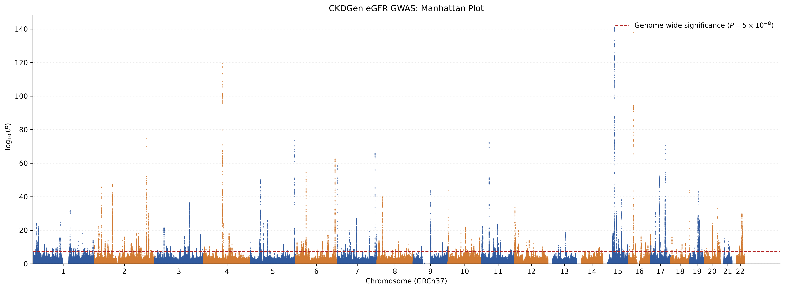
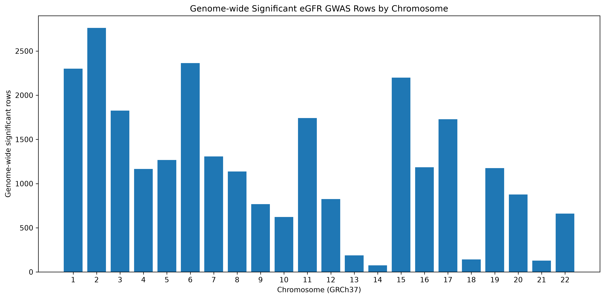
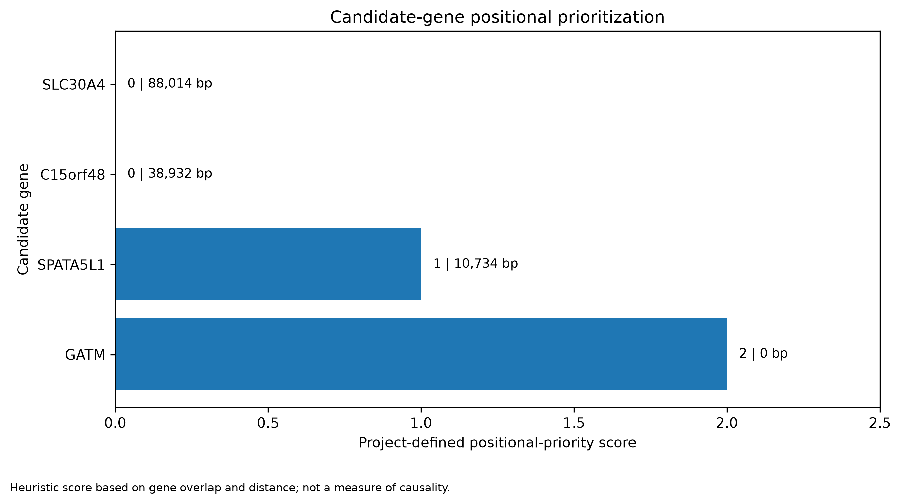
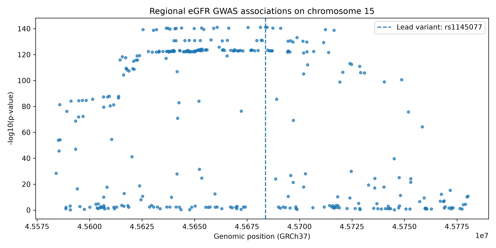

# CKD Genetic Target Prioritization

A bioinformatics project to study genetic variants linked to kidney function and identify genes for further research in chronic kidney disease (CKD).

## What I did

- Analysed GWAS data related to kidney function.
- Found variants with significant associations.
- Studied the region around a lead variant on chromosome 15.
- Compared variant locations with nearby genes.
- Ranked candidate genes based on their positions.
- Created graphs and tables to show the results.

## Data

- Study: Wuttke et al. (2019)
- DOI: https://doi.org/10.1038/s41588-019-0407-x
- Trait: Creatinine-derived eGFR
- Genome build: GRCh37

The study looks at kidney function, not CKD diagnosis directly.

## Main findings

- Analysed around 8.27 million variant records.
- Found 26,442 records with P values below 5 × 10⁻⁸.
- Studied 339 variants around the lead variant rs1145077.
- Ranked GATM highest based on its position.
- Identified SPATA5L1 as another gene for further study.

These findings show associations and positional evidence. They do not prove which gene causes the effect.

## Results and graphs

The project generates four graphs:

- GWAS Manhattan plot: Shows significant associations across the genome.
- Chromosome plot: Shows the distribution of significant records across chromosomes.
- Lead region plot: Shows variant associations around rs1145077.
- Candidate gene plot: Compares positional scores of nearby genes.

Graph files are saved in `results/figures/`.

Other results, including candidate gene tables and reports, are saved in `reports/` and `docs/`.

## Tools used

- Python, pandas and NumPy
- Matplotlib
- pytest
- Git and GitHub
- Ubuntu on WSL

## How to run

Install the required packages:

```bash
python -m pip install -r requirements.txt
```

## Visualizations

#### Genome-wide association signals


The Manhattan plot summarizes genome-wide association signals for creatinine-derived eGFR. The significance threshold and association patterns should be interpreted in the context of the source study and phenotype limitations.

#### Significant variant records by chromosome


This plot shows the chromosome-level distribution of significant variant records. Variant-row counts do not necessarily represent independent genetic signals.

#### Candidate-gene positional prioritization


This heuristic ranks nearby genes using the project's positional evidence, including overlap with the lead variant and distance. GATM receives the highest positional score because the lead variant overlaps its annotated gene boundaries. The score is not a probability of causality and does not establish a causal gene.

### Regional Association Finding

The lead variant identified in the selected region is **rs1145077**, at chromosome 15 position 45,683,795 (GRCh37), with P = 6.85 × 10⁻¹⁴².

The variant overlaps the annotated boundaries of **GATM**, making it a strong positional candidate for follow-up. **SPATA5L1** is another candidate for further investigation based on its proximity and previously reported region-level evidence.

These findings do not establish either gene as causal.

## Repository Structure

- `data/raw/` — source GWAS statistics and gene annotations
- `data/processed/` — intermediate analysis outputs
- `src/` — Python analysis scripts
- `results/figures/` — generated visualizations
- `docs/` — candidate-gene evidence and methodological notes
- `notebooks/` — exploratory analysis
- `tests/` — project tests

Raw and generated data files are excluded from Git where configured in `.gitignore`. Follow the source publication and data-provider terms when obtaining the data.

## Tools

Python, pandas, NumPy, Matplotlib, Git, Linux, and Ubuntu on Windows Subsystem for Linux (WSL).

## Limitations and Next Steps

- Nearby variants may be correlated through linkage disequilibrium (LD); they should not be treated as independent signals without further analysis.
- Positional overlap does not prove that a variant regulates or affects a particular gene.
- Formal fine-mapping requires appropriate linkage disequilibrium information and statistical analysis.
- Candidate-gene prioritization should be strengthened with fine-mapping, kidney-relevant expression quantitative trait loci (eQTLs), colocalization, and independent phenotype evidence.
- Creatinine-derived eGFR findings should be compared with complementary kidney-function phenotypes where suitable data are available.

## Candidate-gene evidence and data validation

The project includes two structured reports for the chromosome 15 eGFR association region:

- `reports/candidate_gene_prioritization.csv` summarizes four candidate genes, their distances from the lead variant, current priorities, and key limitations.
- `reports/variant_gene_evidence.csv` separates positional evidence from genetic and functional evidence, explicitly marking evidence that has not yet been assessed.

GATM has the strongest positional evidence because the lead variant rs1145077 falls within its annotated gene boundaries. SPATA5L1 is a follow-up candidate based on evidence described in the literature review. These assessments do not establish a causal gene.

### Data validation and tests

The validation script checks the candidate-gene prioritization table:

```bash
python src/validate_candidate_genes.py
```

Run the automated tests with:

```bash
python -m pytest -v
```

The test suite checks gene-name uniqueness, non-negative distances, documented evidence fields, expected gene coverage, and completeness of the variant-to-gene evidence table.

## Installation and setup

### 1. Clone the repository

```bash
git clone https://github.com/Palak-Git29/ckd-genetic-target-prioritization.git
cd ckd-genetic-target-prioritization
```

### 2. Create and activate a virtual environment

```bash
python3 -m venv .venv
source .venv/bin/activate
```

### 3. Install dependencies

```bash
python -m pip install -r requirements.txt
```

### 4. Run the complete pipeline

From the repository root, run:

```bash
python run_pipeline.py

```

The runner executes the analysis scripts in sequence, generates processed datasets and figures, validates the candidate-gene table, and stops if a step fails.

Required raw GWAS summary statistics and gene annotation files must be available in `data/raw/`. Raw input files are excluded from Git.

### 5. Run validation tests

```bash
python -m pytest -v
```

The tests validate candidate-gene prioritization and variant-to-gene evidence tables.
